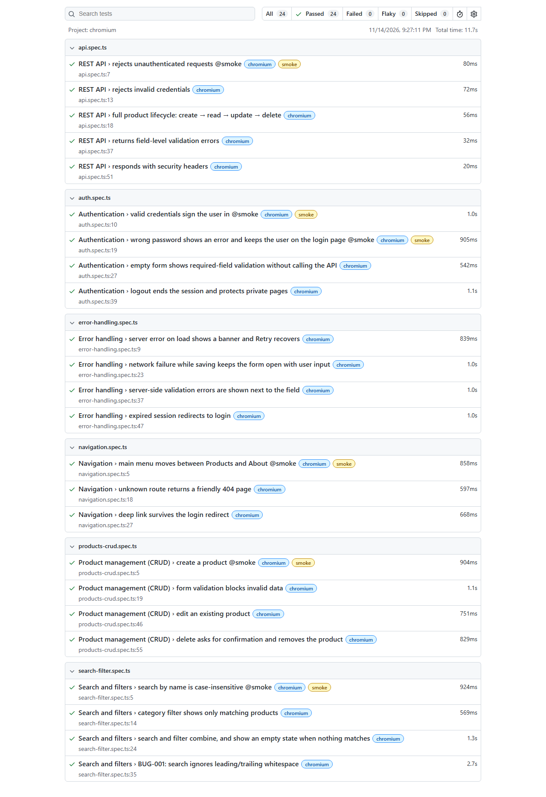
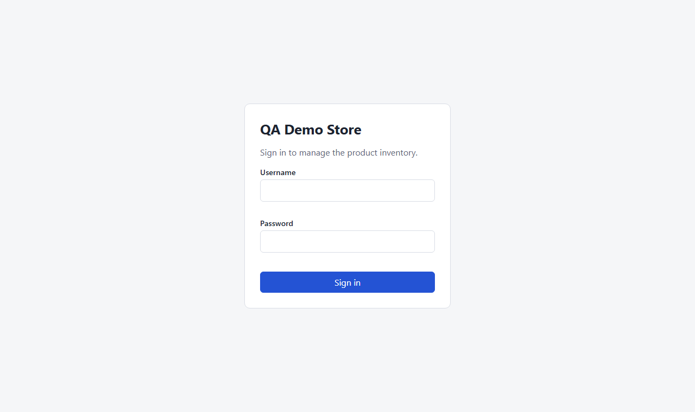
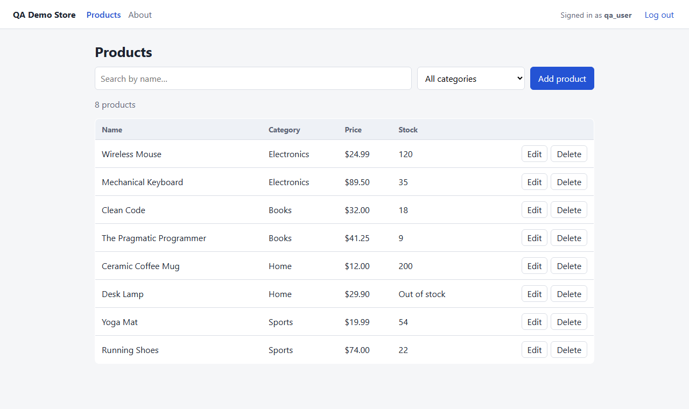
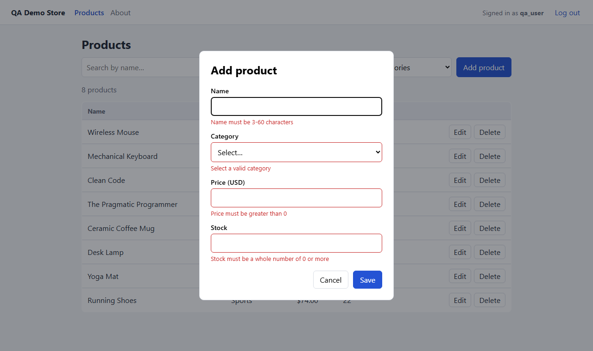

# Playwright QA Automation Portfolio


A production-style end-to-end and API test automation framework built with **Playwright + TypeScript**. It tests a small inventory web app (**QA Demo Store**) that ships with the repo, so anyone can clone it and run the whole suite in under a minute, with no accounts, Docker or paid services.

> This repository is a working sample of how I approach test automation for clients: stable tests, clear reports, CI from day one, and honest bug reporting.

<p align="center"></p>

---

## Highlights

| | |
|---|---|
| **24 automated tests** | UI (E2E) + REST API, across 6 feature areas |
| **0 flaky tests** | Verified with `--repeat-each=5` (120/120 passing) |
| **~12 s** full run | Parallel and isolated: each test gets its own data session |
| **Page Object Model** | Readable specs, one place to update selectors |
| **Accessible locators** | `getByRole` / `getByLabel` first, `data-testid` as fallback |
| **Failure evidence** | Screenshot + video + Playwright trace kept on failure |
| **CI/CD** | GitHub Actions on push, PR, weekday schedule and manual run |
| **Cross-browser** | Chromium, Firefox, WebKit and mobile Chrome projects |
| **Bug tracking demo** | A known defect (BUG-001) tracked with `test.fail()` plus a client-ready bug report |

## Feature coverage

| Area | Scenario | Spec |
|---|---|---|
| Authentication | Valid login redirects and shows the user | `auth.spec.ts` |
| | Wrong password shows an error | `auth.spec.ts` |
| | Required-field validation, with no API call made | `auth.spec.ts` |
| | Logout ends the session; private pages are protected | `auth.spec.ts` |
| Navigation | Main menu, active link state | `navigation.spec.ts` |
| | 404 page for unknown routes | `navigation.spec.ts` |
| | Deep link preserved through login redirect | `navigation.spec.ts` |
| Search & filters | Case-insensitive search | `search-filter.spec.ts` |
| | Category filter | `search-filter.spec.ts` |
| | Combined search + filter, empty state | `search-filter.spec.ts` |
| | **BUG-001**: whitespace in the search query (known defect) | `search-filter.spec.ts` |
| CRUD | Create product | `products-crud.spec.ts` |
| | Client-side form validation (4 rules, focus management) | `products-crud.spec.ts` |
| | Edit product | `products-crud.spec.ts` |
| | Delete with confirm / cancel | `products-crud.spec.ts` |
| Error handling | HTTP 500 on load → error banner → Retry recovers | `error-handling.spec.ts` |
| | Network failure on save keeps the user's input | `error-handling.spec.ts` |
| | Server-side validation errors mapped to fields | `error-handling.spec.ts` |
| | Expired session redirects to login | `error-handling.spec.ts` |
| REST API | 401 for unauthenticated / bad credentials | `api.spec.ts` |
| | Full create → read → update → delete lifecycle | `api.spec.ts` |
| | Field-level 400 validation contract | `api.spec.ts` |
| | Security headers | `api.spec.ts` |

## Quick start

**Requirements:** Node.js ≥ 20.12 and Git. Works on Windows, macOS and Linux.

```bash
git clone https://github.com/<your-user>/playwright-qa-automation-portfolio.git
cd playwright-qa-automation-portfolio
npm ci
npx playwright install chromium
npm test
```

The demo app starts automatically (Playwright `webServer`) on `http://localhost:3000`.

| Command | What it does |
|---|---|
| `npm test` | Full suite in Chromium (headless) |
| `npm run test:smoke` | Only `@smoke` tagged tests |
| `npm run test:headed` | Watch the browser while tests run |
| `npm run test:ui` | Playwright UI mode (time-travel debugging) |
| `npm run test:all-browsers` | Chromium, Firefox, WebKit, mobile (`npx playwright install` first) |
| `npm run report` | Open the last HTML report |
| `npm run typecheck` | TypeScript strict check |
| `npm start` | Run the demo app manually at http://localhost:3000 |
| `npm run screenshots` | Regenerate the screenshots in `docs/screenshots` |

### Configuration

Copy `.env.example` to `.env` to override defaults. `.env` is git-ignored.

| Variable | Purpose | Default |
|---|---|---|
| `DEMO_USER` / `DEMO_PASS` | Credentials used by both the demo app and the tests | demo-only values |
| `PORT` | Local app port | `3000` |
| `BASE_URL` | Run against an already-running or deployed environment (skips starting the local server) | – |

In CI, credentials come from **GitHub Secrets** (`DEMO_USER`, `DEMO_PASS`). No real secrets are stored in this repository.

## Architecture

```
.
├── app/                      # Application under test (zero-dependency Node server)
│   ├── server.js             # REST API + pages, per-session in-memory data
│   └── public/               # HTML, CSS, vanilla JS
├── tests/
│   ├── pages/                # Page Objects (LoginPage, ProductsPage + ProductForm)
│   ├── support/
│   │   ├── fixtures.ts       # Custom fixtures (API login → authenticated page)
│   │   ├── env.ts            # Environment-driven config
│   │   └── test-data.ts      # Builders, unique data, seed constants
│   └── specs/                # Test specs grouped by feature
├── scripts/                  # Deterministic helper scripts (screenshots)
├── docs/                     # Bug report sample, test report sample, screenshots
├── business/                 # Freelance service material (proposals, pricing, estimator)
├── .github/workflows/        # CI pipeline
└── playwright.config.ts
```

See [docs/architecture.md](docs/architecture.md) for the design decisions.

**Key design choices**

- **API login in fixtures.** Only the auth specs log in through the UI. Every other test authenticates through the API (~50 ms), which makes the suite faster and more stable.
- **Data isolation by design.** Each session gets a fresh copy of the seed data, so tests never share state and run fully in parallel.
- **Deterministic failure simulation.** Outages, 500s and 401s are produced with `page.route()` network interception rather than by breaking real services.
- **No arbitrary waits.** No `waitForTimeout` anywhere. All synchronisation uses Playwright's auto-waiting, web-first assertions.
- **Limited retries.** Retries are 0 locally and 2 in CI. A test that passes only on retry is reported as *flaky* rather than hidden.

## Reports and failure artifacts

- **HTML report:** `playwright-report/index.html` (`npm run report`). In CI it is uploaded as a build artifact on every run.
- **On failure:** screenshot, video and a full **trace** (DOM snapshots, network, console) are kept in `test-results/`. Open a trace with `npx playwright show-trace <path>/trace.zip`.
- **JUnit XML** is produced in CI (`test-results/junit.xml`) for integration with other dashboards.

| Login | Products | Validation |
|---|---|---|
|  |  |  |

Example client deliverables:

- [Sample test execution report](docs/sample-test-report.md)
- [Sample bug report (BUG-001)](docs/sample-bug-report.md)

## Application bugs vs automation failures

When a test fails, I triage before reporting:

| Signal | Likely cause | Action |
|---|---|---|
| Fails consistently, same assertion, reproducible by hand | **Application bug** | Bug report with steps, evidence, severity |
| Fails intermittently, passes on retry | **Flaky test** (timing, shared data) | Fix the test; never just add retries |
| Locator not found after a UI change | **Test maintenance** | Update the Page Object |
| Everything fails at once | **Environment** (server down, bad credentials) | Check the health endpoint and config |

**BUG-001** demonstrates this workflow. The search box does not trim whitespace. The test is marked `test.fail()` with an `issue` annotation, so CI stays green while the bug is open, and the test will alert the team as soon as the bug is fixed.

## CI/CD

`.github/workflows/playwright.yml`:

- Triggers: push to `main`, pull requests, **scheduled run on weekdays at 06:00 UTC**, and manual dispatch with a browser selector.
- npm and browser caching, type check, test run, HTML report artifact, and failure artifacts (screenshots, videos, traces).
- Least-privilege `permissions: contents: read`; concurrency cancels outdated runs.

## Known limitations

- The application under test is a purpose-built demo, so real client apps will need their own Page Objects and test data strategy.
- Data is held in memory and resets when the server restarts, so there is no database layer to test here.
- Visual regression, accessibility audits (axe) and performance testing are not included in this MVP. They are natural extensions.
- Only Chromium runs by default in CI to keep it fast. Use the manual dispatch with `all` for the full browser matrix.
- BUG-001 is an intentional defect kept for demonstration purposes.

## About

Built by a full-stack developer offering **QA automation services**: test strategy, Playwright E2E and API suites, CI integration and bug reporting. I use AI-assisted tooling to speed up test authoring, and every test is reviewed, executed and verified.

License: MIT
